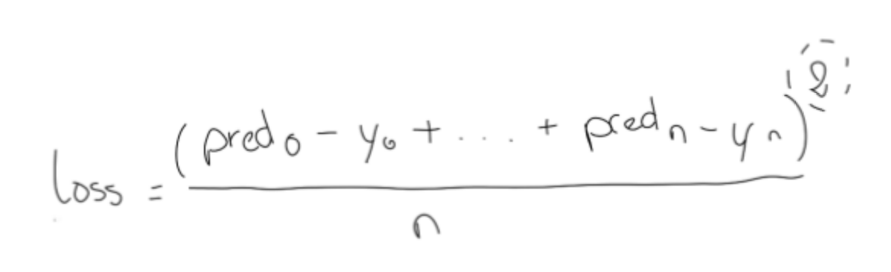
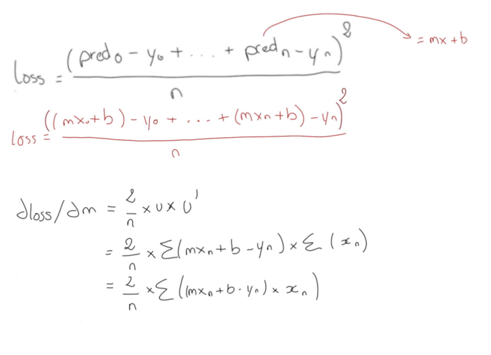
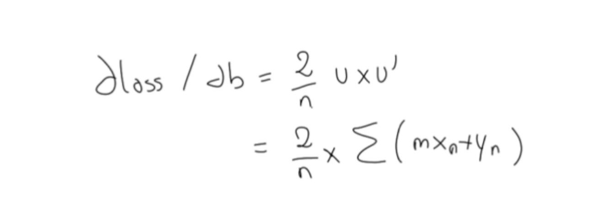
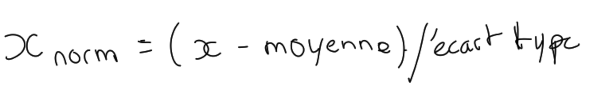
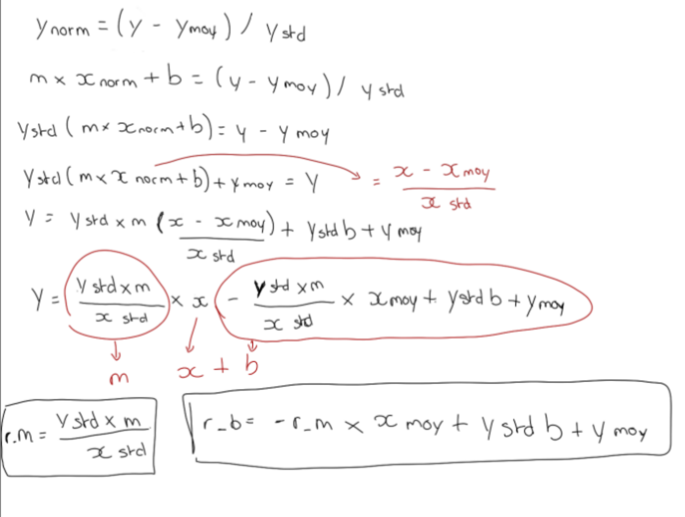

# Régression linéaire

La **régression linéaire** est une méthode de *machine learning* utilisée pour prédire une valeur numérique à partir d'une ou plusieurs variables d'entrée.

Son objectif est de trouver la droite qui représente le mieux la relation entre les données observées afin de pouvoir prédire de nouvelles valeurs.


---

## Principe

La prédiction est donnée par la formule :

\[
y = mx + b
\]

où :

- **y** : la valeur à prédire (ici, le prix de la voiture).
- **m** : la pente de la droite.
- **x** : la variable d'entrée (ici, le kilométrage de la voiture).
- **b** : l'ordonnée à l'origine.

---

## Entraînement

### La fonction de perte (Loss)

La **Loss** mesure la qualité de notre droite de régression.



Elle correspond à la moyenne des carrés des écarts entre les prédictions et les vraies valeurs :

- Plus la Loss est faible, plus notre modèle est précis.
- Les erreurs sont mises **au carré** :
  - pour éviter que les erreurs positives et négatives s'annulent ;
  - pour pénaliser davantage les grandes erreurs.

---

### Le gradient

Le **gradient** permet de savoir comment modifier les paramètres **m** (la pente) et **b** (l'ordonnée à l'origine) afin de réduire la Loss.

Dans notre cas, on parle plus précisément des **dérivées partielles** de la fonction de perte.

#### Gradient par rapport à `m`



On rappelle que :

- notre prédiction est :

\[
 y = mx + b
\]

- et que la dérivée de \(u^2\) est :

\[
(u^2)' = 2u u'
\]

En appliquant cette règle de dérivation, on obtient la dérivée partielle de la Loss par rapport à **m**.

#### Gradient par rapport à `b`

Le même raisonnement permet d'obtenir la dérivée partielle par rapport à **b**.



---

## Mise à jour des paramètres

Une fois les gradients calculés, on met à jour les paramètres :

\[
m = m - alpha gradient_m
\]

\[
b = b - alpha gradient_b
\]

Cette opération est répétée jusqu'à ce que la Loss ne diminue plus de manière significative.

### Le taux d'apprentissage (Learning Rate)

Le paramètre **α (alpha)** est appelé **taux d'apprentissage** (*learning rate*).

Il contrôle l'amplitude des mises à jour :

- un **alpha trop grand** peut empêcher la convergence ;
- un **alpha trop petit** rend l'apprentissage très lent.

---

### Normalisation

La normalisation des données est une étape importante avant l'apprentissage du modèle. 
Sans normalisation, certaines variables peuvent avoir des valeurs beaucoup plus grandes que d'autres, ce qui entraîne un gradient trop élevé.

Le modèle devrait alors utiliser un taux d'apprentissage (`alpha`) plus faible pour éviter de dépasser la solution optimale, mais cela rendrait l'apprentissage beaucoup plus lent.

On applique donc une normalisation des données :



Une fois la prédiction effectuée, il est nécessaire de revenir aux valeurs originales grâce à la dénormalisation :



- isoler la variable cible `y` ;
- retrouver les paramètres de la droite de régression `m` et `b`.

## Lancement

```bash
source venv/bin/activate
pip install -r requirements.txt
```

---

## Sources

- https://developers.google.com/machine-learning/crash-course/linear-regression?hl=fr