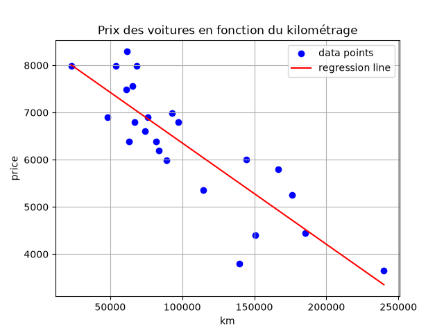

# Linear regression

**La régression linéaire** est une méthode de machine learning utilisée pour prédire une valeur numérique à partir d'une ou plusieurs variables d'entrée. Elle cherche à tracer la droite qui représente le mieux la relation entre les données observées afin d'estimer de nouvelles valeurs.

## Prédiction

L'expression de la prédiction est défini comme y = mx + b, où

    y correspond aux prix de la voiture, soit la valeur que nous voulons prédire.
    m est la pente de la droite.
    x est le kilométrqge de la voiture, c'est-à-dire notre valeur d'entrée.
    b est l'ordonnée à l'origine.

## Entrainement

Loss -> Indique la précision de notre droite de régression

Gradient -> Variable qui permet de modifier notre pente et notre ordonnée à l'origine qvec une certaine intensité

Alpha -> Constante qui permet d'appliquer un coéfficient d'apprentissage

## Sources

https://developers.google.com/machine-learning/crash-course/linear-regression?hl=fr